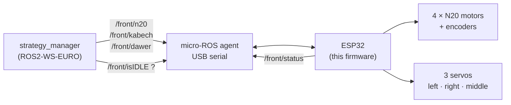

# System_code_ESP32_front — Front mechanism controller

ESP32 firmware for the **front pick-up mechanism** of AEROBOTIX INSAT's EUROBOT 2026 robot. It drives four N20 gear motors that lower and raise the suction arms, plus three servos that align and spread the game elements. The Raspberry Pi controls it through **micro-ROS** over USB serial.

The back mechanism runs the same firmware with different pins and calibration: [System_code_ESP32_back](https://github.com/Eurobot-2026-Aerobotix/System_code_ESP32_back). The suction pumps and valves are on a separate board: [System_Code_ESP32_pneumatic](https://github.com/Eurobot-2026-Aerobotix/System_Code_ESP32_pneumatic).

## How it fits



## ROS interface

All entities use **reliable** QoS (depth 5).

| Name | Type | Direction | Meaning |
|---|---|---|---|
| `/front/n20` | `std_msgs/Int32` | subscribe | Position of the four arms (see below) |
| `/front/kabech` | `std_msgs/Int32` | subscribe | Left/right servos: `1` align the elements, `0` retract, any other value = intermediate position |
| `/front/dawer` | `std_msgs/Int32` | subscribe | Middle servo: `1` spread, `0` close |
| `/front/isIDLE` | `std_srvs/Trigger` | service | `success = true` when every arm has reached its target |
| `/front/status` | `std_msgs/Int64` | publish | Heartbeat with the four encoder counts packed as `e0/10·10⁹ + e1/10·10⁶ + e2/10·10³ + e3/10` |

### `/front/n20` values

The value is read as **four decimal digits, one per arm**. The first digit is arm 0 (the rightmost arm, seen from above with the ESP32's USB port facing down):

| Digit | Arm position |
|---|---|
| `1` | down (pick) |
| `2` | prepare (just above the elements) |
| `3` | middle |
| `0` or other | up |

| Special value | Effect |
|---|---|
| `0` | Re-home all arms against their top end stop |
| `20` | Reboot the ESP32 |

Examples: `1111` lowers all four arms, `2222` puts them all in *prepare*, `1001` lowers only the two outer arms.

Try it from the Pi:

```bash
ros2 topic pub --once /front/n20 std_msgs/msg/Int32 "{data: 2222}"
ros2 service call /front/isIDLE std_srvs/srv/Trigger
```

## How it works

- **Two FreeRTOS tasks:** one runs micro-ROS, the other runs the motor position loop.
- **Position control:** each N20 has a quadrature encoder read by the ESP32 hardware pulse counter (PCNT) and its own PID controller (gains `kp`, `ki`, `kd` per motor, integral reset on sign change and clamped). The target positions for *up / middle / prepare / down* are calibrated per arm (`upPosition`, `midPosition`, `preparePosition`, `downPosition`).
- **Homing:** at start-up, and on command `0`, every arm is driven upward until its encoder stops changing; that position becomes zero.
- **Robust link:** a state machine (`AGENT_WAIT → AVAILABLE → CONNECTED → DISCONNECTED`) pings the agent and recreates the ROS entities after a disconnection, and the board can also be rebooted remotely with `20`.
- **Serial test mode:** `test_with_serial()` accepts commands typed on the serial monitor (`uuuu`, `pppp`, `mmmm`, `dddd`, or `<motor><count>`). It is commented out in `loop()` for the competition build; re-enable it to test without ROS.

## Hardware

| Part | Pins (`src/main.cpp`) |
|---|---|
| ESP32 (uPesy WROOM) | — |
| 4 × N20 motor, H-bridge `A` / `B` / `EN` | `motorPinsA` `{2,4,5,15}`, `motorPinsB` `{19,14,23,16}`, `motorPinsEnable` `{18,12,21,22}` — PWM 20 kHz, 8-bit |
| 4 × quadrature encoder | `encoderPinsA` `{36,35,25,27}`, `encoderPinsB` `{39,34,32,26}` |
| Servos | middle 17, left 13, right 33 |

Servo angles for each position are the `*_servo_pos_*` constants at the top of `src/main.cpp`. They differ between the front and back boards, so recalibrate after any mechanical change.

## Build and flash

Requirements: [PlatformIO](https://platformio.org/) (CLI or VS Code extension).

```bash
pio run                    # build (downloads micro_ros_arduino for Jazzy)
pio run -t upload          # flash over USB
pio device monitor         # serial monitor, 115200 baud
```

Then start an agent on the Pi (the dashboard's agents service does this automatically):

```bash
ros2 run micro_ros_agent micro_ros_agent serial --dev /dev/ttyUSB0 -b 115200
```

## Safety

Keep fingers away from the arms when the board boots: homing drives every motor upward at full power until it hits its end stop.
